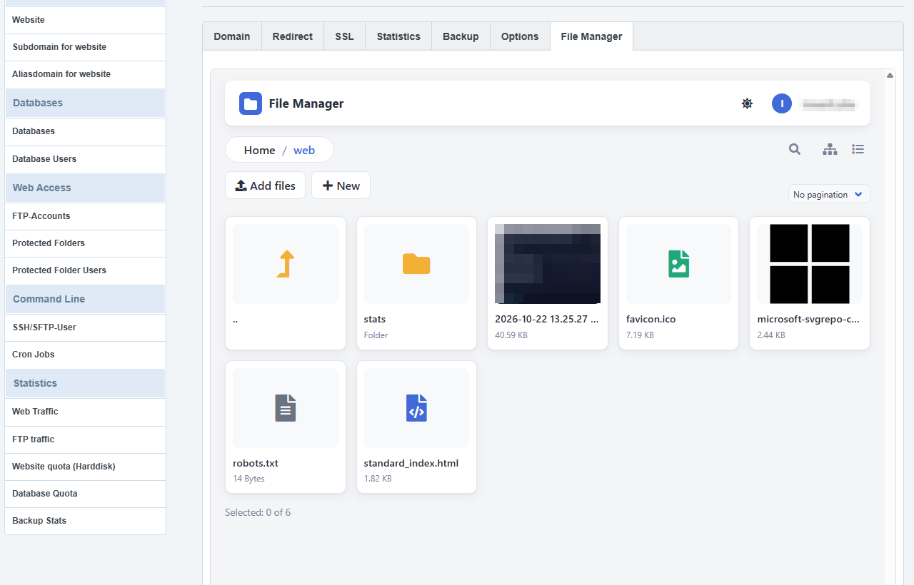

# File Manager for ISPConfig

A modern file manager that lives inside the ISPConfig control panel: a **File Manager tab on every website** (next to
Domain, Redirect, SSL, Statistics, Backup, Options). An optional **Sites → File Manager** side-menu entry (website picker) is added with `--with-menu`.
People open it from the panel and are **signed in automatically**: no second login. It works on the website's real files
through the server's own FTP service, so it can never reach more than FTP could.



- Grid and list views, image thumbnails, light and dark theme (follows the panel's theme), works on phones
- Code editor: syntax colours, bracket matching, find & replace, full screen (over the whole panel)
- Upload (drag and drop, large files), download, rename, move, copy, zip, unzip, permissions
- "Upload from URL" with a progress bar (public web addresses only)
- Admins see every website; clients see only their own (ISPConfig's own permission rules decide)
- Nothing in ISPConfig is edited, so ISPConfig updates don't break it

## Quick install

On the ISPConfig server, as root:

```bash
curl -fsSL https://raw.githubusercontent.com/hmsiddiki/ispconfig-filemanager/main/get.sh | sudo bash
```

It downloads the latest release, **verifies its checksum**, checks your server, installs, and tests itself.

If your ISPConfig panel is not on port 8080 (for example it runs on 2087), pass the port. The `-s --` is required: it hands the flag to the installer instead of to bash.

```bash
curl -fsSL https://raw.githubusercontent.com/hmsiddiki/ispconfig-filemanager/main/get.sh | sudo bash -s -- --panel-port 2087
```

To only look first: add `-s -- --check` (`... | sudo bash -s -- --check`), which changes nothing.

Prefer to read before you run? Download `ispconfig-filemanager-X.Y.Z.tar.gz` from the
[Releases](../../releases) page, then:

```bash
tar xzf ispconfig-filemanager-*.tar.gz && cd ispconfig-filemanager-*/
sudo ./install.sh --check     # looks at the server and changes nothing
sudo ./install.sh             # installs
```

Then open the panel: open a website (**Sites → Website → click the website**) and click its **File Manager** tab.
(With `--with-menu`, also **Sites → File Manager** in the side menu.)

## Updating to a new release

Run the installer again on each server, as root. It sees the existing install and updates it in place.

**1. Look first** (changes nothing):

```bash
curl -fsSL https://raw.githubusercontent.com/hmsiddiki/ispconfig-filemanager/main/get.sh | sudo bash -s -- --check
```

**2. Update:**

```bash
curl -fsSL https://raw.githubusercontent.com/hmsiddiki/ispconfig-filemanager/main/get.sh | sudo bash
```

This installs the **latest release**. To install one particular version instead (this is also how you go back to an older one):

```bash
curl -fsSL https://raw.githubusercontent.com/hmsiddiki/ispconfig-filemanager/main/get.sh | sudo bash -s -- --version 1.2.0
```

If your panel is not on port 8080, add `--panel-port 2087` (your port) the same way as in the install command above.

**What an update does**

- Replaces the program files, the front end, the panel page and the clean-up script.
- **Keeps** your `configuration.php` and your keys. Nothing you configured is lost, so there is nothing to back up first. (The one exception is the old 100 MB upload default, which is raised to 2 GB; see below.)
- Checks the download against its checksum and runs the same self-tests as a fresh install; if a test fails, nothing is switched on.
- People who have the file manager open may need to reopen it from the panel (it gets a new temporary login).

**After updating, check**

1. Open a website's **File Manager** tab: it should load and show the files.
2. Press **Ctrl+F5** once in your browser, so it loads the new front end instead of a cached one.

**Upload limit.** The default upload limit is now **2 GB** (it was 100 MB). When you update, a server that still has the old 100 MB default is raised to 2 GB automatically, and the installer says so. A value you set yourself (anything other than the old default) is never changed. To choose another limit, edit `frontend_config.upload_max_size` in `/usr/local/ispconfig/filemanager/configuration.php`, for example `500 * 1024 * 1024`; it takes effect on the next request, there is nothing to restart.

**Other settings** are not touched by an update, because your `configuration.php` is kept. The only new optional one is `unzip_php_cli`: if Unzip says it cannot start, add the full path of the command-line PHP, for example `'unzip_php_cli' => '/usr/bin/php',`.

**Needed since 1.2.0.** The background Unzip uses the command-line PHP and, for `.tar`, `.tar.gz`, `.tgz`, `.tar.bz2` and `.tar.xz`, the `tar` program. Standard ISPConfig servers have both. `.zip` needs the PHP `zip` extension, which is already required (see below).

**If something goes wrong,** install the previous version again with `--version` (for example `--version 1.1.0`). Your configuration is kept in that direction too.

## What you need

| | |
|---|---|
| ISPConfig | 3.2 or 3.3 (tested on **3.3.2p1**) |
| FTP server | **Pure-FTPd with MySQL**: ISPConfig's default |
| PHP | 8.1 or newer for the panel, with the extensions `ftp curl openssl mbstring zip mysqli posix` |
| Panel web server | nginx (tested). Apache should work but is untested |
| Access | `root` on the server |
| Servers | **One server** (the panel and the websites on the same machine). Multi-server setups are not supported yet |

The installer checks all of this and stops with a clear message if something is missing.

### What has and hasn't been tested

Tested end to end: ISPConfig 3.3.2p1, Debian 12, nginx, Pure-FTPd/MySQL, PHP 8.2, admin account, one website: the tab and
menu entry, automatic sign-in, browsing, the editor, upload from URL, and the installer/uninstaller. **Not yet tested:**
client (non-admin) accounts, Apache panels, other distributions, ISPConfig 3.2, multi-server setups. Reports are welcome.

## The installer

The installer **tests itself on your server before it switches anything on**: it makes a temporary FTP account for your
first website, logs in with it, reads the folder, checks a wrong password is refused, removes the account, and finally
requests the file manager *through the panel's web server* to prove sessions and logs work there. Only when every step
passes does it add the menu entry, the tab and the clean-up job. If a step fails nothing is switched on.

```
--panel-dir DIR     ISPConfig folder                          default /usr/local/ispconfig
--panel-port PORT   port the panel answers on                 default 8080
--ftp-host HOST     where Pure-FTPd listens                   default 127.0.0.1
--ftp-port PORT                                               default 21
--ttl-hours N       how long one file manager session lasts   default 8 (1–72)
--with-menu         also add a Sites > File Manager side-menu entry   default: off
--check             only check, change nothing
```

**Update:** see [Updating to a new release](#updating-to-a-new-release) above.

**Uninstall:** `sudo ispconfig-filemanager-uninstall` (the installer puts this command in `/usr/local/sbin`, owned by root; it asks first, `--yes` skips the question). It removes the file manager, its menu entry,
tab, cron job and every temporary FTP account it made. ISPConfig, your websites and their files are not touched.

## How it works

```
 person in the panel ── website's File Manager tab ──▶ panel page (checks who they are, which websites they may open)
                                                          │  creates a TEMPORARY FTP account for that website
                                                          │  (expires on its own, hidden from clients)
                                                          ▼
                                       single-use encrypted token (60 s) ──▶ file manager, inside the panel page
                                                                              │
                                                                  FTP on 127.0.0.1 as that account
                                                                              ▼
                                                                    the website's files, as its own system user
```

- **Who may open what** is decided by ISPConfig itself (`getAuthSQL`), the same rules as the rest of the panel. Clients
  whose limits switch FTP off get a notice instead.
- **Temporary FTP account:** random name and password, jailed (chroot) to the website folder by Pure-FTPd, files created
  as the website's own user (never root), owned by the *admin* group so a client never sees it in their FTP user list.
  It **expires after 8 hours**: Pure-FTPd itself refuses it after that. A cron job (`/etc/cron.d/ispconfig-filemanager`,
  every 10 minutes) deletes old rows.
- **The password is never stored and never shown.** It exists only inside the login token (AES-256-GCM, 60 seconds,
  single use) and then, encrypted, in the file manager's server-side session. The token is removed from the address bar
  right after use.
- **Nothing is typed in the file manager.** In panel mode it has no login form and refuses typed logins. A visitor with no
  panel login can do nothing: every action answers "Not Found".
- **Upload from URL** only fetches public web addresses: private networks, loopback, cloud metadata services, odd IP
  encodings, redirects into those, and DNS tricks are all refused; size and time are limited.

## Where things are installed

| Path | What |
|---|---|
| `/usr/local/ispconfig/filemanager/` | program, libraries, `configuration.php`, `private/keys/` (read-only for the web server) |
| `/usr/local/ispconfig/interface/web/filemanager/index.php` | the panel page (website picker, makes the token) |
| `/usr/local/ispconfig/interface/web/filemanager/app/` | the file manager's public files (`index.php`, scripts, styles) |
| `/usr/local/ispconfig/interface/temp/filemanager/` | logs, sessions, scratch space (written by the web server) |
| `…/interface/web/sites/lib/menu.d/filemanager.menu.php` | the optional **Sites → File Manager** menu entry (`--with-menu`) |
| `…/interface/web/js/js.d/filemanager-tab.js` | adds the **File Manager** tab to each website's page |
| `/etc/cron.d/ispconfig-filemanager` | clean-up job |
| `/usr/local/sbin/ispconfig-filemanager-uninstall` | the uninstaller (root-owned, deliberately outside every folder the panel can write to) |

Everything uses folders ISPConfig leaves alone during its own updates (a new `filemanager` folder, the `menu.d` and `js.d`
drop-in folders, `interface/temp`), and **no ISPConfig file is edited**.

> **Why the data folder is under `interface/temp`:** on current Debian and Ubuntu the panel's PHP service runs sandboxed
> (`ProtectSystem=full`), which makes everything under `/usr` read-only to it except the one folder ISPConfig allows,
> `interface/temp`. Anything the app writes must be there. The installer handles this; no systemd change is needed.

> **About the tab:** ISPConfig has no official way to add a tab to a form (the tab list is fixed in its own
> `web_vhost_domain.tform.php`, which every update overwrites). The tab is added in the browser by `js.d/filemanager-tab.js`:
> ISPConfig loads every `*.js` file in that folder and fires an `onAfterContentLoad` hook after each page. A custom panel
> theme keeps working as long as it keeps ISPConfig's own page structure (`.content-tab-wrapper`, `#tabbox_content`).

## Settings

Edit `/usr/local/ispconfig/filemanager/configuration.php` (changes apply immediately):

| Setting | Meaning |
|---|---|
| `frontend_config.default_view` | `'grid'` or `'list'`: what people see until they pick |
| `frontend_config.max_width` | widest the content gets, in px (an embedded file manager always fills its frame) |
| `url_upload.enabled` / `max_size` / `timeout` | "Upload from URL": on/off, size limit per file (default 200 MB), time limit |
| `url_upload.max_concurrent_per_user` / `max_concurrent_total` | downloads at once (default 1 per person, 3 on the server) |
| `unzip_php_cli` | optional: full path of the command-line PHP used for the background unzip worker (default: found next to the PHP the panel runs on) |
| `frontend_config.upload_max_size` | upload size limit per file, checked in the browser and again on the server (default 2 GB; uploads are sent in chunks, so PHP's `upload_max_filesize` does not apply) |
| `frontend_config.editable` | file types that open in the code editor |

The session length (default 8 hours) is set at install time with `--ttl-hours`; re-run the installer to change it.
The panel's nginx allows 20 MB per request (`client_max_body_size`); uploads are sent in 1 MB pieces, so big files work.

## Matching your panel's theme (light / dark)

The file manager has light, dark and automatic modes and a button in its top bar. Inside the panel it follows the panel's
theme **if the theme says what it is**. Any of these on `<html>` or `<body>` is picked up, live:

```html
<html data-theme="dark">     or    <body class="dark">     or    <body class="theme-dark">
<html data-theme="light">    or    <body class="light">    or    <body class="theme-light">
```

When the panel sets one of these, the file manager follows it and hides its own button (so the two can't disagree).
With no signal from the panel, the file manager's own button is used. You can also drive it from your own theme code:

```js
document.getElementById('fm-frame').contentWindow.postMessage({ type: 'filemanager-theme', theme: 'dark' }, location.origin);
```

or open the app with `?theme=dark` / `?theme=light` (valid values: `light`, `dark`, `auto`).

## Troubleshooting

| Symptom | Cause and fix |
|---|---|
| Installer: "missing PHP extension(s)" | `apt install php-ftp php-curl php-mbstring php-zip php-mysql` (names vary by PHP version), then run again |
| Installer: "Pure-FTPd is not running" | this file manager needs ISPConfig's default FTP server |
| No "File Manager" entry or tab | log out of the panel and in again (the menu is built at login); clients with FTP limit 0 get a notice instead |
| "The file manager is not set up correctly: its data folder is not writable" | `/usr/local/ispconfig/interface/temp/filemanager` must be owned by the panel user (`chown -R ispconfig:ispconfig …`), or the panel's PHP service has a different sandbox (see above) |
| "This login link has expired / was already used" | open the file manager again from the panel (links work once, for 60 seconds) |
| "Could not open the website folder" | Pure-FTPd refused the temporary account: check the FTP service and that `ftp_user` has the `expires` column |
| Installer stops with "the panel did not serve the file manager (HTTP 000)": panel not on port 8080 | pass `--panel-port`, e.g. `curl -fsSL https://raw.githubusercontent.com/hmsiddiki/ispconfig-filemanager/main/get.sh \| sudo bash -s -- --panel-port 2087` |
| A client sees no websites | they have none, or none that is an active "vhost" website on this server |
| Logs | `/usr/local/ispconfig/interface/temp/filemanager/logs/app.log` and ISPConfig's own log (Monitor → Logs) |

Good to know: temporary FTP accounts appear for **admins** in *Sites → FTP-Accounts* while they are alive (named `fm…`);
a cap of 20 live ones per website stops abuse; only normal "vhost" websites are listed. The temporary accounts are written
to the database directly (not through ISPConfig's change log), fine on one server, and the reason multi-server setups are
not supported yet. The firewall is not involved: the file manager talks to FTP over `127.0.0.1`.

## Development

```
backend/        PHP application (FileGator-based): storage, login, upload-from-URL, SSO token
frontend/       Vue 2 interface (grid/list, editor, themes)
installer/      what the release package contains besides the program: install.sh, uninstall.sh, panel page,
                menu entry, tab script, templates, self-test
static/         static files copied into the web folder (favicon, logo, manifest)
scripts/        build-package.sh
tests/          PHP tests (login token, upload-from-URL safety, concurrency): ./tests/run.sh
examples/       standalone use (a connection form instead of the panel): nginx rules and a config example
```

Build a release package:

```bash
composer install --no-dev --optimize-autoloader
npm ci --ignore-scripts
NODE_OPTIONS=--openssl-legacy-provider npm run build     # the build tooling (Vue CLI 4) needs this on Node 17+
./scripts/build-package.sh                               # -> release/ispconfig-filemanager-X.Y.Z.tar.gz (+ .sha256)
./tests/run.sh
```

Releases are built by GitHub Actions when a `vX.Y.Z` tag is pushed (see `.github/workflows/release.yml`): the tag must match `VERSION`.

## Security

If you find a vulnerability, please report it privately to the maintainers rather than in a public issue.
Things worth knowing: the file manager runs as the panel's own PHP user and reaches website files only through FTP;
the token key (`private/keys/sso.key`) is the secret that lets the panel sign people in, so keep that file private.

## Licence

MIT. Built on [FileGator](https://github.com/filegator/filegator) (MIT) and other open-source software: see [NOTICE](NOTICE).
